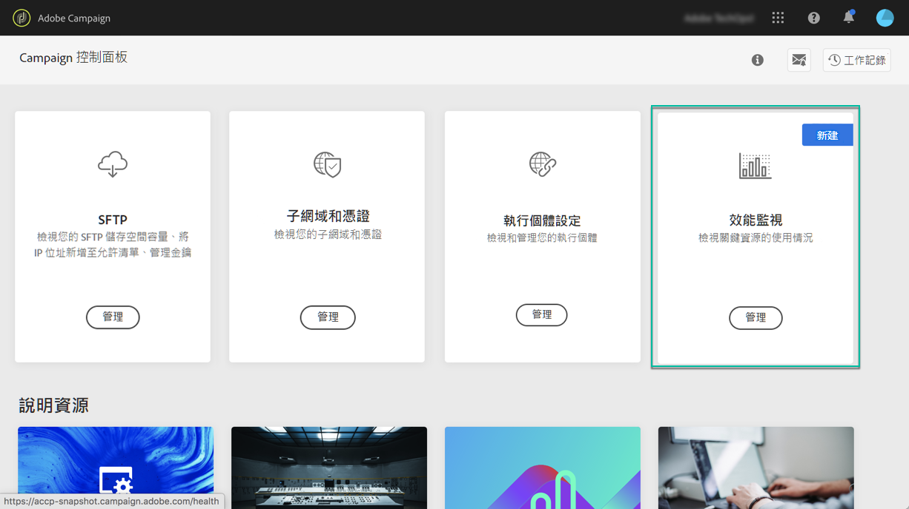

# 關於效能監視 {#about-performance-monitoring}

控制面板提供數種功能，協助您監視執行個體並確保最佳效能。

「控制面板」首頁中的&#x200B;**[!UICONTROL 效能監視]**&#x200B;卡片可讓您監視 Campaign 執行個體的使用情況，例如其資料庫容量。 如需詳細資訊，請參閱[本章節](../../performance-monitoring/using/database-monitoring.md)。

>[!NOTE]
>
>在即將發行的「控制面板」版本中，此卡片會提供其他監視功能。

