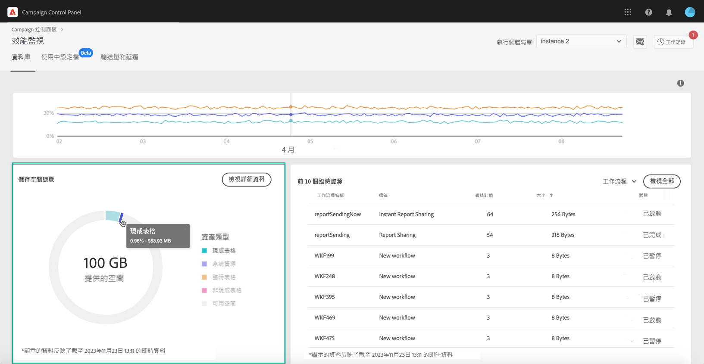
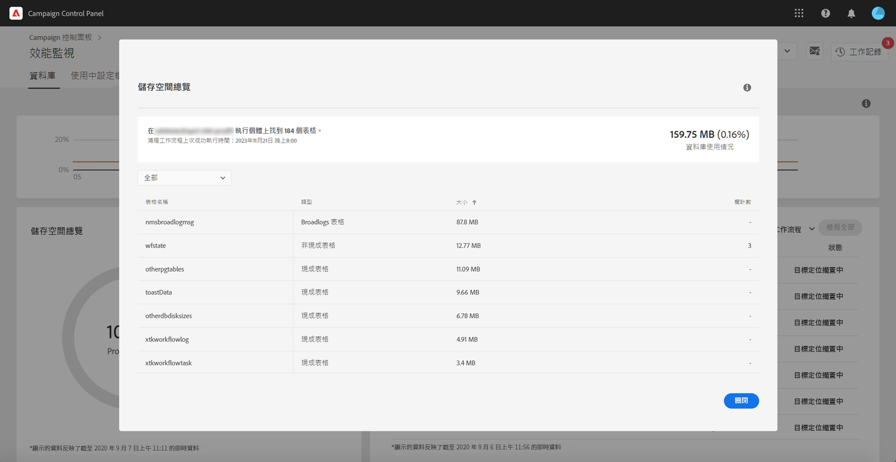

# 儲存空間概觀 {#storage-overview}

>[!CONTEXTUALHELP]
>id="cp_dbdetails_storagedetails"
>title="關於儲存概觀"
>abstract="在此索引標籤中，您可以取得佔用資料庫空間的不同 Campaign 資源的詳細資訊。"

**[!UICONTROL 儲存空間概觀]**&#x200B;區域以圖形呈現以下項目佔用的空間：

* **[!UICONTROL 系統資源]**

  請注意，如果系統資源耗用大部分的資料庫空間，我們建議您聯絡客戶服務。

* 預設會隨 Campaign 執行個體提供的&#x200B;**[!UICONTROL 現成表格]**，
* 透過工作流程和傳遞建立的&#x200B;**[!UICONTROL 臨時表格]**，
* 建立自訂資源後產生的&#x200B;**[!UICONTROL 非現成表格]**。

按一下&#x200B;**[!UICONTROL 檢視詳細資料]**&#x200B;按鈕，以針對佔用資料庫空間的不同資產取得更多詳細資訊。

您可以使用下拉式清單，來縮小搜尋範圍並僅顯示特定資產類型 (工作流程、傳遞、收件者) 的表格。

請注意，此畫面也可讓您監視可能需要特別注意的工作流程參數，以避免執行個體上出現任何問題。 在[本頁](workflow-monitoring.md)中瞭解更多。
